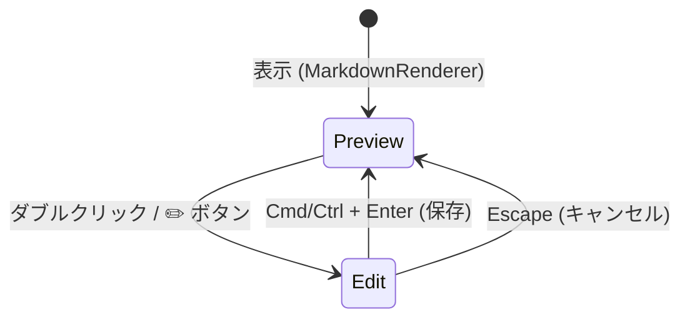

# JotLine UI/UX 機能仕様書 (UI/UX Specification)

---

## 1. 画面レイアウト構成

JotLine は、チャットアプリケーションの親しみやすさとカード型整理ツールの機動力を両立させたインターフェースを提供します。

```text
┌─────────────────────────────────────────────────────────┐
│ ⚡ JotLine [_jotline]       [📋 全件コピー] [📝 エディタ] │ ← 固定ヘッダー
├─────────────────────────────────────────────────────────┤
│                                                         │
│  ┌───────────────────────────────────────────────────┐  │
│  │ ⠿                       [↑][↓][⬆️][💬][✏️][📋][🗑️] │  │ ← カードヘッダー
│  │ 未分類カード1                                     │  │
│  └───────────────────────────────────────────────────┘  │
│                                                         │
│  ▼ 20261013-094500 [✏️] (3)              [📂➖][📋][🗑️] │ ← スレッドヘッダー
│  ┌───────────────────────────────────────────────────┐  │
│  │ ⠿ 親カード                                  [...] │  │
│  │ ⠿ 返信カード1                               [...] │  │
│  │ ⠿ 返信カード2                               [...] │  │
│  └───────────────────────────────────────────────────┘  │
│                                                         │
├─────────────────────────────────────────────────────────┤
│ 2件を選択中                                         [✕] │ ← 選択バー
│ [📁➕] [📂➖] [📋] [🗑️]                                  │   （カード選択時のみ表示）
├─────────────────────────────────────────────────────────┤
│ ══════════════════════ [Drag Handle] ══════════════════ │ ← リサイズハンドル
│ ┌───────────────────────────────────────────────┐ ┌───┐ │
│ │ メモを入力... (Enterで送信、Shift+Enterで改行) │ │ ➤ │ │ ← メイン入力欄 + 送信ボタン
│ └───────────────────────────────────────────────┘ └───┘ │
└─────────────────────────────────────────────────────────┘
```

- ヘッダーのファイル名バッジは拡張子なしのノート名（`basename`）を表示します。
- ラベルは日本語ロケール時の表記です（英語ロケールでは `Copy All` / `Markdown` / `2 selected` など）。
- 選択バーのボタンはアイコンのみで、内容はホバー時のツールチップで示されます。
- カードが1枚もない場合は、タイムライン中央に案内メッセージ（「まだメモがありません」）を表示します。

---

## 2. 入力・キャプチャ機能

### 2.1 メイン入力バー (`InputBar.svelte`)
- **配置**: 画面最下部に固定配置。
- **キー操作**:
  - `Enter`（または送信ボタン「➤」）: メモを即時送信（「未分類」グループの末尾に新規カードとして追記）。未分類グループが複数ある場合は先頭のものに追記し、1つも無い場合はドキュメント末尾に新規作成します。送信後、タイムラインは最下部へ自動スクロールします。
  - `Shift + Enter`: 入力欄内での改行。
- **自動伸縮**: テキストの行数に応じて、1行から最大180pxまで自動で高さを伸縮（手動リサイズ後は、指定した高さを下限として最大400pxまで伸長）。
- **手動リサイズ (ドラッグハンドル)**:
  - 入力バー上部のドラッグハンドルをマウスで垂直方向にドラッグすることで、40px〜400pxの範囲で自由に高さを変更可能。
  - ハンドルを **ダブルクリック** するとデフォルトの高さに即座にリセット。

### 2.2 スレッド返信入力
- 既存カードのアクションバーにある「💬」アイコンをクリックすると、そのカードの直下に1行の返信入力欄が開きます（再クリックで閉じる）。
- `Enter` または「返信」ボタンで送信、`Esc` または「キャンセル」ボタンで入力欄を閉じます。
- 送信すると、親カードが属するスレッドの末尾に新しいカードとして追記されます。
- ※親カードが未分類だった場合は、返信時に新規タイムスタンプ（`YYYYMMDD-HHmmss`）を名前とするスレッドを **ドキュメント末尾** に新規作成し、親カードを未分類グループからそのスレッドへ移動したうえで返信カードを追加します。

### 2.3 リッチ入力サポート
1. **内部リンク補完 (`[[` オートコンプリート)**:
   - メイン入力欄およびカードインライン編集欄で `[[` を入力すると、Vault内のMarkdownノート一覧からリアルタイムインクリメンタル検索を実施（ノート名の部分一致・大文字小文字の区別なし・最大8件表示）。
   - `↑` / `↓` キーまたはマウスクリックで選択、`Enter` / `Tab` で確定挿入（`[[ノート名]]`）、`Esc` でキャンセル。
2. **画像ペースト & ドラッグ＆ドロップ**:
   - クリップボードからの画像ペースト（`Cmd/Ctrl + V`）および入力バーへの画像ファイルのD&D（複数ファイル可）に対応。
   - ObsidianのVaultアタッチメント設定に従い、画像を `Pasted image <タイムスタンプ>.<拡張子>` として自動保存した上で、埋め込みリンク（`![[ファイル名]]`。Obsidianのリンク形式設定によっては ``）を自動挿入。
3. **表データ自動変換**:
   - Excel、Googleスプレッドシート（TSV）やHTMLテーブルのコピーを検知。
   - Markdownテーブル構文（`| ヘッダー | ... |`）へ自動変換して貼り付け（1行目をヘッダー行として扱い、列数が不揃いな行は空セルで補完）。
   - 判定順は 画像 → HTMLテーブル → TSV。TSVはタブと改行の両方を含む複数行データの場合に変換します。
   - ※画像の貼り付け・D&Dおよび表の貼り付け変換はメイン入力バーのみ対応です（カードのインライン編集欄では通常のテキスト貼り付けになります）。

---

## 3. カード操作機能

各カードはプレビュー表示と編集モードを持ち、細やかな構造化操作に対応しています。



- **インライン編集**:
  - カード本文をダブルクリックするか、鉛筆アイコン（✏️）をクリックして編集モードに移行。
  - 編集エリア内でも `[[` 内部リンク補完が利用可能。
  - `Cmd/Ctrl + Enter`（または「保存」ボタン）で保存、`Esc`（または「キャンセル」ボタン）でキャンセル。本文が空（空白のみ）の場合は保存されず、元の内容のまま編集モードを終了します。
- **カードの分割 (`✂️ Split`)**:
  - 編集モード中、カーソル位置で「✂️ カーソル位置で分割（Split at cursor）」ボタンを押すと、その位置でカードを2枚に分割（カーソルより前が元のカードに残り、後ろが直後の新規カードになります。保存ファイル上は間に `<!-- card -->` マーカーが入ります）。
  - カーソルが本文の先頭または末尾にある場合は分割されず、ヒントの通知を表示します。
- **カードの統合 (`⬆️ Merge`)**:
  - カード右上の「上のカードと統合（`⬆️`）」ボタンを押すと、1つ上のカードと改行1つを挟んで結合し、対象カードを安全に削除（ドキュメント全体の先頭カードでは非表示）。
  - グループ先頭のカードの場合は、手前のグループの末尾カードへ統合されます。統合によりカードが0枚になったスレッドは自動的に削除されます。
- **上下移動 (`arrow-up` / `arrow-down`)**:
  - スレッド（または未分類グループ）内で、クリック1回でカード位置を1つ前後に移動（先頭や末尾では非表示）。
- **ドラッグ＆ドロップ並び替え (`⠿`)**:
  - カードをドラッグすることで（左上の `⠿` はドラッグ可能であることを示す目印で、カード全体がドラッグ対象）、同一グループ内での自由な並び替えや、別スレッドへの移動が可能。
  - 別のカードの上にドロップするとそのカードの位置へ、グループの余白にドロップするとそのグループの末尾へ挿入されます。移動によりカードが0枚になったスレッドは自動的に削除されます。
- **コピー (`📋`) / 削除 (`🗑️`)**:
  - カード単体のMarkdownコピー、およびカードの削除（確認ダイアログなしで即時削除。削除によりカードが0枚になったスレッドは自動的に削除されます）。

---

## 4. スレッド（グループ）操作機能

スレッドヘッダーには、グループ全体を効率的に管理するためのアクションが備わっています。

| アクション | アイコン | 説明・動作 |
| :--- | :---: | :--- |
| **アコーディオン開閉** | `chevron-down` / `chevron-right` | ワンクリックでスレッド内の全カードを折りたたみ／展開。折りたたみ時も件数バッジを表示。開閉状態は保存されず、ビューを開き直すと展開状態に戻ります。 |
| **スレッド名リネーム** | ✏️ または タイトルダブルクリック | スレッドタイトルをインライン編集。`Enter` または「✓」で保存、`Esc` または「✕」でキャンセル。 |
| **スレッド解散** | 📂➖ (`folder-minus`) | スレッドを解散し、所属カードをすべて未分類に戻す（カードは削除されない）。カードの位置は動かさず、その場でスレッド名のみを外して未分類グループ化します。 |
| **スレッドMarkdownコピー** | 📋 (`copy`) | 所属カードを空行区切りで連結したMarkdownをクリップボードにコピー（スレッド名は出力に含まれません）。 |
| **スレッド削除** | 🗑️ (`trash`) | スレッドおよび所属するすべてのカードを一括削除（確認ダイアログなしで即時実行）。 |

---

## 5. 複数カードの選択 & 選択アクションバー

`Shift + クリック`（範囲選択）および `Cmd/Ctrl + クリック`（個別選択）により、複数カードをまとめて操作できます。

- 選択は `Cmd/Ctrl + クリック`（またはカードの右クリック）で開始します。`Shift + クリック` は、直前に `Cmd/Ctrl + クリック` / 右クリックしたカードを起点とした範囲選択です（グループをまたいだ範囲も選択可能）。
- 修飾キーなしでカードをクリックすると、選択はすべて解除されます。
- カード内のボタン・入力欄・編集エリア・ドラッグハンドル上のクリックは選択操作の対象外です。

### 選択アクションバー（2行レイアウト）
カードを1枚以上選択すると、入力バーの直上に選択アクションバーが表示されます：

- **1行目（ステータス & 解除）**:
  - 「n件を選択中」（英語ロケール: `n selected`）という選択件数表示。
  - 右端の「✕」ボタン（または `Esc` キー）で選択状態を一括解除。`Esc` はJotLineビュー内にフォーカスがある場合に有効で、カード編集欄・スレッド名編集欄・返信入力欄・リンクサジェスト表示中は、それぞれのキャンセル操作が優先されます。
- **2行目（アクションボタン）**:
  - 📁➕ **グループ化 (`folder-plus`)**: 選択したカード群を新しいスレッドとしてグループ化（先頭カードの位置にスレッドを生成。スレッド名は `YYYYMMDD-HHmmss` のタイムスタンプ。異なるグループのカードをまとめることも可能。1枚だけの選択でもスレッド化できます）。
  - 📂➖ **グループ化解除 (`folder-minus`)**: スレッド所属カードが含まれる場合に表示。選択カードを未分類グループへ戻す（スレッド内の全カードが対象の場合は、位置を動かさずその場でスレッドを解散）。
  - 📋 **Markdownコピー (`copy`)**: 選択したカード群をマーカーなしMarkdownとしてコピー。
  - 🗑️ **一括削除 (`trash`)**: 選択カードを一括削除（確認ダイアログなしで即時実行）。
- **右クリックコンテキストメニュー**:
  - 選択カード上を右クリックしても、同様のアクションメニュー（グループ化／グループ化解除／コピー／削除／選択解除）が利用可能です。
  - 未選択のカードを右クリックした場合は、そのカード1枚だけが選択され、単一カード用メニュー（このカードをグループ化 または グループ化解除／Markdownとしてコピー／カードを削除）が表示されます。

---

## 6. エクスポート（抽出）機能

JotLine は思考の「最終出口」として、標準Markdownへのクリップボードコピーをワンクリックで実行できるように設計されています。

- **カード単体コピー**: カードの「📋」ボタンから、そのカードのMarkdownをコピー。
- **スレッドコピー**: スレッドヘッダーのコピーボタン（`copy`）から、スレッド単位でコピー。
- **選択カードコピー**: 選択バーまたはコンテキストメニューのコピー（`copy`）から、ドキュメント上の並び順でコピー。
- **タイムライン全体コピー**: JotLineヘッダー右上の「📋 全件コピー（Copy All）」ボタンから、ドキュメント全体のMarkdownをコピー。
- **共通仕様**: すべてのコピー処理において、プラグイン制御用のHTMLコメントマーカーは自動的に除去され、綺麗なMarkdownのみがクリップボードに格納されます。複数カードは空行1行で区切って連結され、スレッド名（グループ名）は出力に含まれません。

---

## 7. キーボードショートカット一覧

| キー操作 | フォーカス / 対象領域 | 動作 |
| :--- | :--- | :--- |
| `Enter` | メイン入力欄 | メモの即時送信（未分類カード追加） |
| `Shift + Enter` | メイン入力欄 | 入力欄内での改行 |
| `↑` / `↓` | `[[` リンクサジェスト | 候補ノートの選択移動 |
| `Enter` / `Tab` | `[[` リンクサジェスト | 選択したノートリンク（`[[...]]`）の確定挿入 |
| `Escape` | `[[` リンクサジェスト | サジェスト候補ポップアップを閉じる |
| `Shift + Click` | カード一覧 | 直前に `Cmd/Ctrl + Click`（または右クリック）したカードからの範囲選択 |
| `Cmd/Ctrl + Click` | カード一覧 | カードの個別選択 / 選択解除トグル |
| ダブルクリック | カード本文 | インライン編集モードの開始 |
| `Cmd/Ctrl + Enter` | カード編集欄 | 編集内容の保存 |
| `Escape` | カード編集欄 | 編集のキャンセル（元の状態に復帰） |
| ダブルクリック | スレッドタイトル | スレッド名のインライン編集開始 |
| `Enter` | スレッド名編集欄 | スレッド名の確定保存 |
| `Escape` | スレッド名編集欄 | スレッド名編集のキャンセル |
| `Enter` | 返信入力欄 | 返信の送信 |
| `Escape` | 返信入力欄 | 返信入力欄を閉じる |
| `Escape` | カード選択時（編集欄・返信欄等の外） | 全選択状態の解除 |
