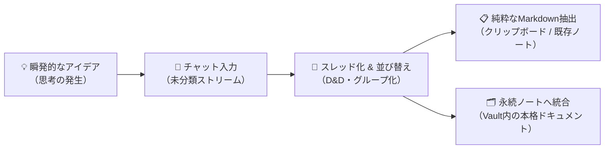

# JotLine プロダクト概要書 (Overview)

> **Stream-based Quick-Capture & Card Organizer for Obsidian**

---

## 1. ビジョンと解決する課題

### 1.1 背景と課題
従来のノートアプリやObsidianの標準エディタでは、**「思考の収集（クイックキャプチャ）」** と **「構造化・整理（ドキュメント化）」** が同じ画面・同じ操作体系の上で行われます。この結果、以下のような課題が生じていました：

- **思考の分断**: メモを取るたびに「どのフォルダの、どのファイルに、どの見出しレベルで書くべきか」を考える必要があり、瞬時のアイデア記録が阻害される。
- **後からの整理コスト**: 1つの長いデイリーノートに書き殴ったメモは、後から切り出して別のノートへ移動したり、トピックごとに並び替えたりする作業が煩雑になる。
- **専用アプリとの断絶**: LINEやSlackのようなチャットUIはキャプチャに優れているが、ObsidianのナレッジグラフやローカルMarkdownエコシステムと分断されてしまう。

### 1.2 JotLine が提供する価値
JotLine は、この **「収集」と「整理」をシームレスに繋ぐ** ためのObsidianコミュニティプラグインです。

1. **瞬発的なキャプチャ（収集）**: チャットUIのように画面下部の固定入力バーから `Enter` 一発で断片的な思考をストリーム状に蓄積。
2. **直感的な構造化（整理）**: 蓄積したカードをドラッグ＆ドロップで並び替えたり、スレッド化（グループ化）してトピックごとに集約。
3. **安全で純粋なエクスポート（活用）**: 不要な独自記法を残さず、いつでも標準Markdownとしてクリップボードや通常ノートへ抽出・活用。



---

## 2. コアコンセプト

### 2.1 チャット風ストリーム × カードUI
- **タイムライン表示**: 送信されたメモは即座に1枚のカードとしてストリームに追加されます。
- **見出し・書式の自由度**: カード内では見出し（`#`）、リスト（`-`）、水平線（`---`）、数式、画像埋め込みなどObsidianの全Markdown表現がそのまま利用できます。

### 2.2 スレッド化による思考の階層化
- 親カードに対して「返信（💬）」を行うことで、自然な会話スレッドのようにカード群をまとめられます。
- スレッドはアコーディオン形式で折りたたみ・展開でき、長大なストリームでも視認性を損ないません。

### 2.3 プラグイン独自ロックインの排除（Pure Markdown）
- 独自データベース（SQLiteやJSON等）を持たず、**純粋なMarkdownファイル + 非破壊的なHTMLコメント** のみでデータを管理します。
- いつでも通常のエディタで開いて閲覧・手動編集ができ、プラグインを無効化してもデータが失われません。

### 2.4 ハイブリッドな運用形態
- **グローバル・スクラッチパッド**: 日常の一時メモ・思考プールとして `_jotline.md` を常駐利用。
- **任意ノートのJotLine化**: 既存の講義ノート、ミーティング議事録、ブレスト用ノートをワンクリックでJotLineビューに切り替えて整理。

---

## 3. ドキュメント構成（ドキュメントマップ）

本プロジェクトの設計・仕様ドキュメントは、関心事ごとに以下の構成に分割・体系化されています：

```text
docs/architecture/
 ├─ README.md                  # 正本ドキュメントの置き場所の説明と文書一覧
 ├─ 00.Overview.md             # 【本書】製品ビジョン、コンセプト、全体像
 ├─ 01.Architecture.md         # システム構造、Svelte/Store設計、イベントループ、技術スタック
 ├─ 02.Data-Format-Spec.md     # Markdown HTMLコメント仕様、パース・シリアライズ、フェイルセーフ
 ├─ 03.UI-UX-Specification.md  # 画面レイアウト、カード・スレッド操作、ショートカット、リッチペースト
 └─ 04.Non-Functional.md      # ファイル同期・競合防止、i18n設計、非機能要件
```

### 各ドキュメントへのリンク
- **システム構造と内部設計を知りたい**: [`01.Architecture.md`](01.Architecture.md)
- **データの保存構文やパーサー仕様を知りたい**: [`02.Data-Format-Spec.md`](02.Data-Format-Spec.md)
- **UIの動作、操作法、キーボードショートカットを確認したい**: [`03.UI-UX-Specification.md`](03.UI-UX-Specification.md)
- **競合制御、同期、国際化、安全設計を確認したい**: [`04.Non-Functional.md`](04.Non-Functional.md)
