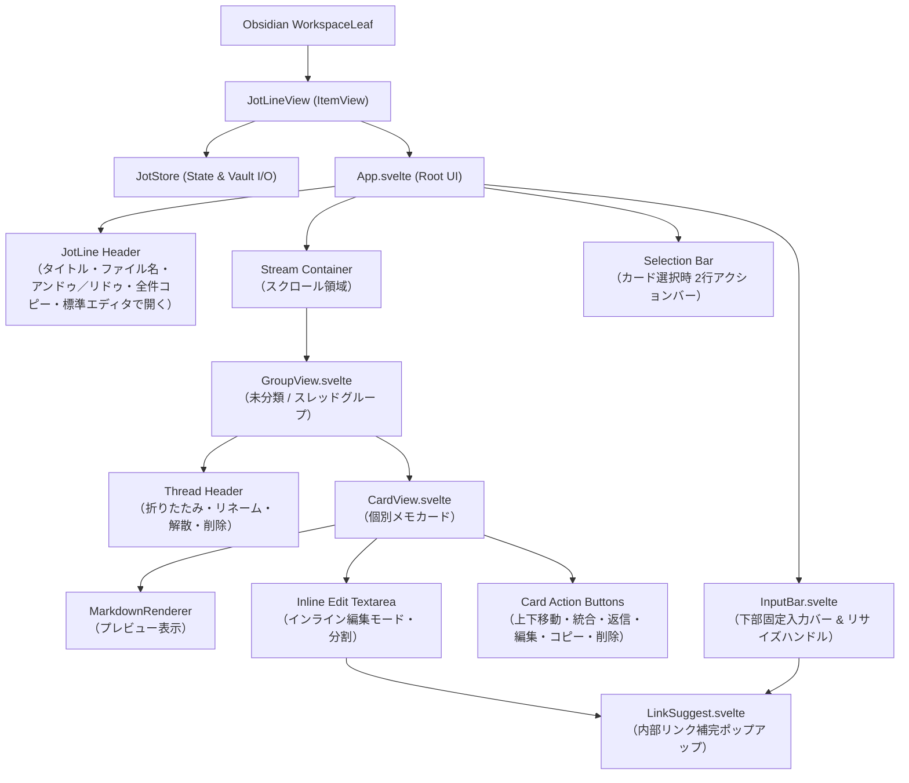
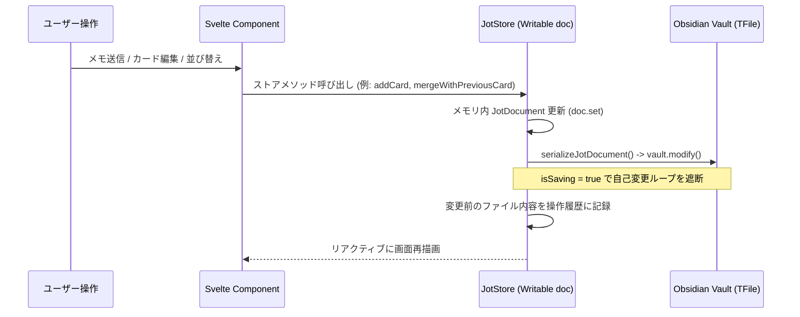
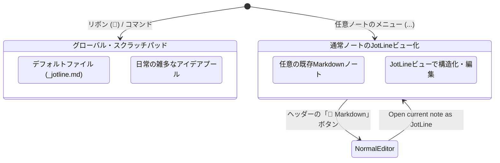
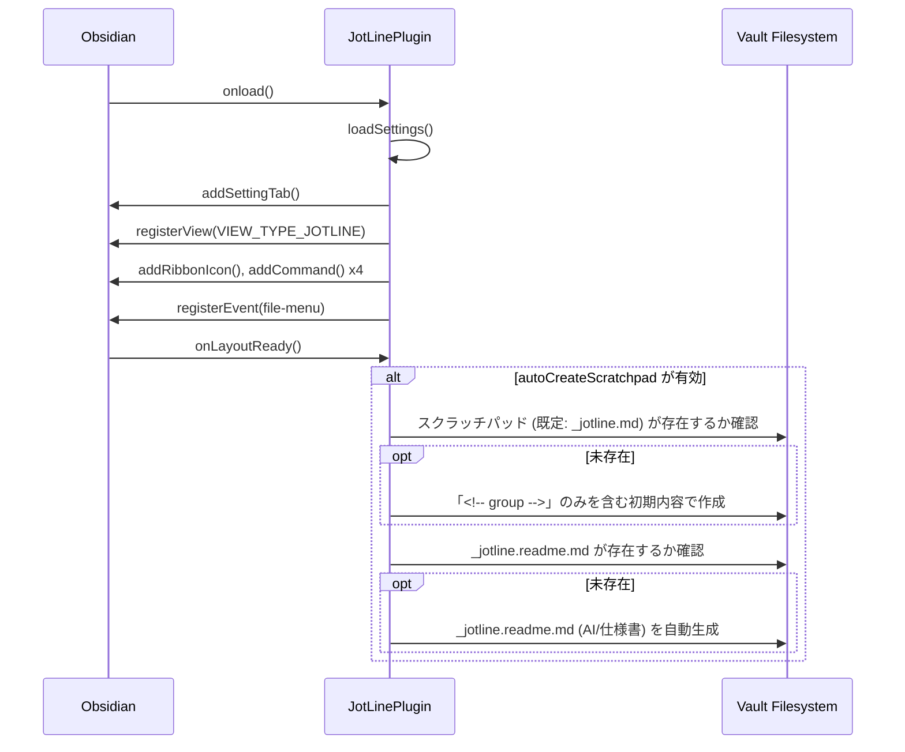

# JotLine システムアーキテクチャ設計書 (Architecture)

---

## 1. システム構成と技術スタック

JotLine は、Obsidian のプラグインAPIをベースに、Svelte による高応答なリアクティブUIと、プレーンテキストMarkdownに対する高速なパーサー層を組み合わせた構成となっています。

| 領域 | 採用技術 | 選定理由・役割 |
| :--- | :--- | :--- |
| **実行環境** | Obsidian プラグイン API | Obsidian Desktop (macOS, Windows, Linux) および Mobile に対応 |
| **開発言語** | TypeScript (ES2022) | 型安全性、リファクタリング耐性、保守性の確保 |
| **UIフレームワーク** | Svelte 4 | 仮想DOMオーバーヘッドのない超軽量コンパイル、ObsidianのDOM親和性 |
| **レンダリング基盤** | Obsidian `MarkdownRenderer` | 数式・内部リンク・画像・コールアウト等のObsidian標準リッチ描画 |
| **ビルド基盤** | esbuild + esbuild-svelte | SvelteコンポーネントのCSSを `main.js` にインライン統合（`css: "injected"`）した単一バンドル配布 |
| **テストフレームワーク** | Vitest | 高速な単体テスト実行環境（パーサー、ユーティリティ、i18n、操作履歴、`JotStore`）。`obsidian` パッケージは型定義のみのため、テスト時は `vitest.config.mjs` の alias で `src/__mocks__/obsidian.ts`（最小限の代替実装）に差し替える |

---

## 2. コンポーネント構造とUI階層

Obsidian の `ItemView` を拡張した `JotLineView` の `contentEl` 内に Svelte アプリケーション（`App.svelte`）をマウントします。



### 主要コンポーネントの責務
- **`JotLineView.ts`**: Obsidian のビューライフサイクルを管理。`setFile(file)` で対象ファイル（`TFile`）ごとに `JotStore` と `App.svelte` を生成・マウントし、`onClose` で両者を破棄。
- **`App.svelte`**: 全体のレイアウト管理（ヘッダー・タイムライン・選択バー・入力バー）、複数選択状態のハンドリング、右クリックコンテキストメニュー、一括操作。ヘッダーのアンドゥ／リドゥボタン、アンドゥ／リドゥのキー操作（`Ctrl/Cmd+Z` など）、`Esc` による選択解除もここで処理（それ以外のキーボード操作は `InputBar` / `CardView` / `GroupView` が個別に処理）。表示の置き換え（アンドゥ／リドゥ／外部変更による読み直し）を検知してカードの選択を解除する。
- **`GroupView.svelte`**: スレッドグループ（アコーディオンヘッダー、カード一覧）の描画とドラッグ＆ドロップ受け入れ。
- **`CardView.svelte`**: 各カードのプレビュー表示（`MarkdownRenderer`）、インライン編集、カード単位のアクション（分割、統合、返信、上下移動、コピー、削除）、ドラッグ開始。
- **`InputBar.svelte`**: メイン入力エリア、高さの自動伸縮、マウスドラッグによる垂直リサイズ（40px〜400px）、画像/表データの貼り付け検知、画像ファイルのドロップ受け入れ。
- **`LinkSuggest.svelte`**: `[[` 入力時にVault内の全Markdownノート名を部分一致でインクリメンタル検索（最大8件表示）し、確定時にコールバックで親（`InputBar` / `CardView`）へ通知。`[[ノート名]]` の挿入は親側で実施。

---

## 3. 状態管理（State Management: `JotStore`）

状態管理には Svelte の `Writable` ストアを採用し、**Single Source of Truth（唯一の信頼できる情報源）** として `src/store.ts` の `JotStore` クラスに集約しています。



### `JotStore` の主要データ構造
```typescript
export interface JotDocument {
    groups: JotGroup[];
}

export interface JotGroup {
    id: string;        // 一意なグループID（パース時に採番。ファイルには保存されない）
    name: string;      // スレッド名（"" の場合は未分類）
    cards: JotCard[];  // 所属カード配列
}

export interface JotCard {
    id: string;        // 一意なカードID（パース時に採番。ファイルには保存されない）
    content: string;   // Markdownテキスト本文
}
```

### 操作履歴（アンドゥ／リドゥ）

`JotStore` は、アンドゥ／リドゥのための操作履歴を持ちます。

- **履歴の1件**: 変更直前の **ファイル内容（Markdownテキスト全体）のスナップショット**。外部変更の前の状態や、マーカーのない通常のノートの元のテキストを、パース・シリアライズで形を変えずにそのまま戻せます。
- **履歴を積むタイミング**:
  - JotLine上の操作：各操作メソッド（`addCard` など14個）が最後に呼ぶ保存処理（`save()`）の中で、書き込みに成功したら変更前の内容を積む。1回の操作 = 1件。内容が変わらない操作（例：先頭カードの上移動）では、書き込みも記録もしない。
  - 外部変更：`modify` イベントで読み直した内容が直前の内容と異なれば、変更前の内容を積む（検知1回 = 1件）。
  - 新しい履歴を積むと、リドゥ履歴は破棄する。
- **アンドゥ／リドゥ（`undo()` / `redo()`）**: 戻り先のスナップショットをファイルへ書き込み、パースし直して表示を置き換える。書き込みに失敗した場合は、取り出した履歴を元に戻す。書き込み中に重ねて実行されたものは無視する。
- **保持**: メモリ上のみ（ファイルには保存しない）。上限100件で、超えた分は古いものから破棄する。履歴は `JotStore` のインスタンスが持つため、ビューを閉じるか別のファイルに切り替える（`JotStore` が作り直される）と破棄される。
- **構成**:
  - `src/history.ts` の `UndoHistory`：アンドゥ／リドゥの2本のスタックと上限の管理。Obsidian・Svelte に依存しない。
  - `JotStore` の状態：`currentText`（最後に読み書きしたファイル内容）、`history`、`isApplying`（書き込み中フラグ）。
  - UI 向けのストア：`historyState`（`canUndo` / `canRedo`。ボタンの有効／無効とコマンドの実行可否に使う）、`replacedCount`（表示を置き換えた回数。アンドゥ／リドゥ／外部変更による読み直しで増え、UI はこれを購読して選択を解除する）。
- **操作の入口**: ヘッダーのボタン・ビュー内のキー操作（`App.svelte`）と、コマンド `jotline-undo` / `jotline-redo`（`main.ts`。既定のホットキーなし。アクティブなビューが JotLine ビューで、実行できる履歴があるときだけ有効）。

---

## 4. ハイブリッド設計（スクラッチパッド vs 任意ノート）

JotLine は、特定の単一ファイル専用プラグインではありません。2つの運用形態をシームレスにサポートします。



1. **グローバルスクラッチパッドモード**:
   - プラグイン設定で指定されたパス（デフォルト: `_jotline.md`）を開きます。
   - どの作業をしていても、リボンアイコンやコマンド（`Open JotLine scratchpad`。ホットキーは任意で割り当て可能）から即座に呼び出せます。
   - **右サイドバー** に開きます。既に同じファイルを開いている JotLine ビューがあれば、それを再利用します。
2. **任意ノートのJotLineビュー化モード**:
   - ノートのその他メニュー（`...`）・ファイルツリーの右クリックメニュー、またはコマンドパレットから「Open current note as JotLine（現在のノートをJotLineとして開く）」を選択。
   - 現在アクティブなペイン（メインエディタ領域）に開きます。
   - 任意のノートをJotLineのチャット＆カードUIで閲覧・操作可能。
   - JotLineヘッダーの「📝 Markdown（エディタ）」ボタンを押せば、いつでも同じファイルをObsidian標準のエディタで開けます。

---

## 5. ライフサイクルと初期生成フロー

プラグインの有効化からビュー起動までのシーケンスは以下の通りです：



- **初期ファイルの生成タイミング**:
  - 上記の起動時（`onLayoutReady`）に加え、スクラッチパッドを開く操作（リボン / コマンド）の際にも同じ存在チェックと生成（`initDefaultFiles`）が実行されます。いずれも `autoCreateScratchpad` が有効な場合のみで、無効時にスクラッチパッドが存在しなければ通知を表示して開きません。
- **`_jotline.readme.md` の自動生成**:
  - Vaultルートに固定パスで生成されます（内容は日本語の固定テンプレート `src/templates/readmeTemplate.ts`）。既に存在する場合は上書きしません。
  - 人間だけでなく、Vaultを読み書きするLLM/AIエージェント向けに、JotLineのデータ境界ルール（HTMLコメント規約）や推奨操作方法を記した仕様書ファイルを自動配備します。
