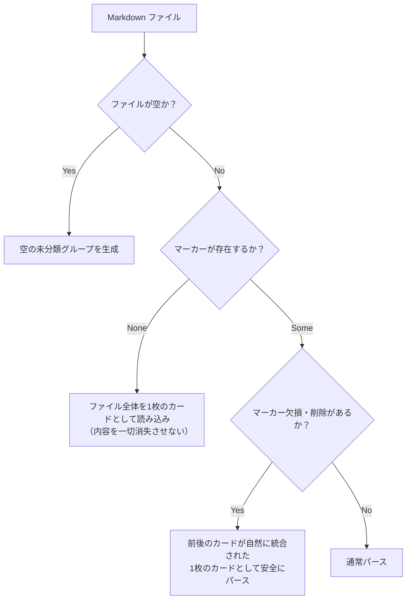

# JotLine データフォーマット仕様書 (Data Format Specification)

---

## 1. データ設計方針

JotLine は、Obsidian の基本理念である **「プレーンテキストによる永続性」「ベンダーロックインの排除」** を最重要視して設計されています。

1. **純粋なMarkdownの維持**:
   - 独自バイナリやJSON等の隠しデータベースを一切使用せず、すべてのデータを `.md` ファイル内にそのまま保存します。
2. **非破壊的なHTMLコメントマーカー**:
   - データの境界マーカーとして標準的な **HTMLコメント (`<!-- ... -->`)** を採用。
   - Obsidianの標準プレビューや他のMarkdownビューワーで開いた場合、コメントは非表示となるため、通常のドキュメントとしてそのまま閲覧可能です。
3. **Markdown記法の無制限な自由度**:
   - 見出し（`#` 〜 `######`）、水平線（`---`）、箇条書きリスト、チェックボックス、コードブロック、LaTeX数式、内部リンク（`[[...]]`）、画像埋め込みなどを、カード本文内で何ら制限なく自由に記述できます。

---

## 2. マーカー構文規則

パーサーは以下の2種類のHTMLコメントを行単位で認識します。

| マーカー種別 | 構文例 | 判定用正規表現 | 説明 |
| :--- | :--- | :--- | :--- |
| **グループ宣言** | `<!-- group -->`<br/>`<!-- group: 議事録 -->` | `/^<!--\s*group(?::\s*(.*?))?\s*-->$/i` | 新しいグループ（スレッド）の開始を宣言。名前を省略した場合は「未分類（デフォルト）」扱いとなる。 |
| **カード境界** | `<!-- card -->` | `/^<!--\s*card\s*-->$/i` | 個別のカードの開始（直前カードの終端）を宣言。 |

> [!NOTE]
> - 大文字・小文字は区別されません（`<!-- CARD -->` や `<!-- Group: Foo -->` も有効）。
> - マーカー内側の空白、および行頭・行末の空白は任意です（行を trim してから判定します）。
> - マーカーは **単独の行** に記述する必要があります（本文と同じ行にあるコメントはマーカーとして認識されず、本文として扱われます）。
> - スレッド作成時のデフォルト名には、`YYYYMMDD-HHmmss` 形式のタイムスタンプ（例: `20261013-094500`）が自動付与されます。

---

## 3. フォーマット実例

### 3.1 生のMarkdownファイル（保存フォーマット）
```markdown
<!-- group -->
<!-- card -->
単発でキャプチャしたメモ1（未分類扱い）

<!-- card -->
単発でキャプチャしたメモ2
- リスト項目A
- リスト項目B

<!-- group: 20261013-094500 -->
<!-- card -->
親となるカード（スレッドの起点）
### メモ内見出し
水平線や見出しも自由に記述可能
---

<!-- card -->
親カードへの「返信」として追加されたメモ

<!-- group: ブレインストーミング -->
<!-- card -->
名前付きスレッドの1枚目カード
```

### 3.2 パース後の内部データ構造（JSON表現）
```json
{
  "groups": [
    {
      "id": "g_default",
      "name": "",
      "cards": [
        {
          "id": "c1",
          "content": "単発でキャプチャしたメモ1（未分類扱い）"
        },
        {
          "id": "c2",
          "content": "単発でキャプチャしたメモ2\n- リスト項目A\n- リスト項目B"
        }
      ]
    },
    {
      "id": "g_thread1",
      "name": "20261013-094500",
      "cards": [
        {
          "id": "c3",
          "content": "親となるカード（スレッドの起点）\n### メモ内見出し\n水平線や見出しも自由に記述可能\n---"
        },
        {
          "id": "c4",
          "content": "親カードへの「返信」として追加されたメモ"
        }
      ]
    },
    {
      "id": "g_thread2",
      "name": "ブレインストーミング",
      "cards": [
        {
          "id": "c5",
          "content": "名前付きスレッドの1枚目カード"
        }
      ]
    }
  ]
}
```

> [!NOTE]
> - 上記の `id` は説明用の値です。実際のIDは `generateId()` によるランダム文字列で、**パースのたびに新規採番** されます（ファイルには保存されません）。
> - カード本文（`content`）は前後の空白・空行が trim された状態で保持されます。

---

## 4. パース & シリアライズのアルゴリズム

### 4.1 パース処理 (`parseJotDocument`)
1. テキストを行単位（`\r?\n`）に分割して順次スキャン。
2. `<!-- group -->` / `<!-- group: ... -->` を検知した際、直前まで蓄積されたカード・グループを確定（Commit）し、新しいグループを開始。
3. `<!-- card -->` を検知した際、直前のカード行を本文として確定し、新しいカードを開始。
4. マーカー以外の行は現在のカード本文バッファへ追加（最初のマーカーより前の本文や、グループ宣言直後に `<!-- card -->` なしで書かれた本文も、1枚のカードとして取り込まれます）。
5. ファイル末尾で最後のカードおよびグループを確定。
6. **空カードの除外**: 空行のみで構成されるカードは生成をスキップし、マーカー連続によるゴミカードの発生を防止。
7. **空の未分類グループの整理**: 他にグループ（名前付きグループまたはカードを持つ未分類グループ）が存在する場合は、カード0件の未分類グループを除外。結果としてグループが0件となる場合のみ、初期状態となる空の未分類グループを1つ確保。

### 4.2 シリアライズ処理 (`serializeJotDocument`)
1. 各グループをループ処理：
   - スレッド名がある場合: `<!-- group: [スレッド名] -->` を出力（カードが0件でも宣言行のみ出力）。
   - 未分類グループの場合: `<!-- group -->` を出力（※カードが0件かつ未分類の場合は出力自体をスキップ）。
2. 所属カードを順次 `<!-- card -->\n[カード本文（trim済み）]` として、カード間に空行を1行挟んで連結。
3. 各グループ間にも空行を1行挟んで標準Markdownとしての可読性を確保。
4. 出力が空でない場合は末尾に改行を1つ付与（全グループが空の場合は空文字列）。

### 4.3 純粋なMarkdownエクスポート (`exportToPureMarkdown`)
クリップボードへのコピーや他ノートへの転記用に、コメントマーカーを完全に除去したMarkdownを生成します。

- 引数はカードの配列（`JotCard[]`）で、各カード本文を trim し、空のカードを除いたうえで、カード間に空行を1行挟んで連結します。
- グループ（スレッド）の情報は受け取らないため、**スレッド名は出力に含まれません**（見出し等への変換も行いません）。カード単体・スレッド単位・選択カード・全体コピーのいずれも同じ規則です。

---

## 5. フェイルセーフ設計（耐障害性と通常編集への耐性）

ユーザーがObsidian標準エディタや外部エディタで直接ファイルを編集することを前提とした堅牢な設計を行っています。



1. **マーカーが存在しない通常ノートを開いた場合**:
   - エラーで停止したりファイルを初期化することは絶対にありません。
   - ノート全文を「未分類グループの1枚のカード」として安全に読み込みます。
2. **手動編集で `<!-- card -->` マーカーを消してしまった場合**:
   - 前後のカードが結合（マージ）された1つのカードとして解釈され、テキスト内容の消失は防がれます。
3. **空ファイルを開いた場合**:
   - 空の未分類グループを1つ用意し、即座に入力可能な状態として起動します。
