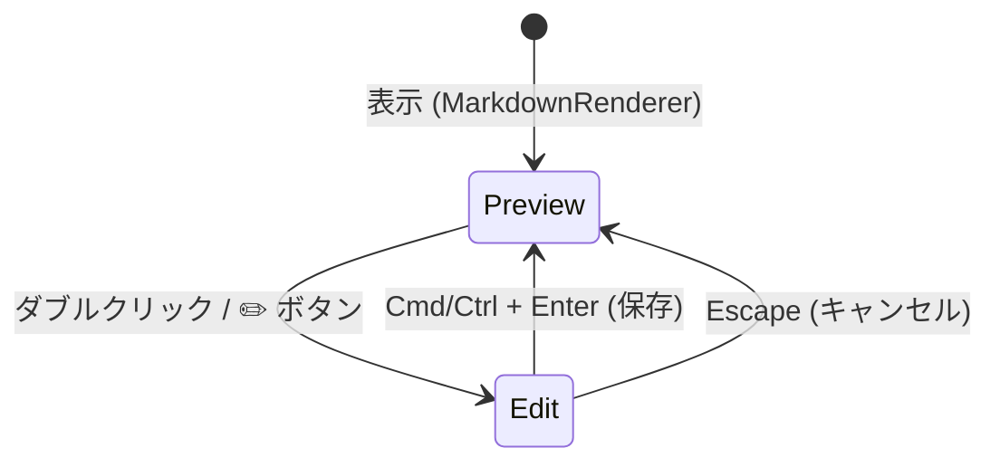

# JotLine UI/UX 機能仕様書 (UI/UX Specification)

---

## 1. 画面レイアウト構成

JotLine は、チャットアプリケーションの親しみやすさとカード型整理ツールの機動力を両立させたインターフェースを提供します。

```text
┌─────────────────────────────────────────────────────────┐
│ ⚡ JotLine [_jotline] [↶][↷] [📋 全件コピー] [📝 エディタ] │ ← 固定ヘッダー
├─────────────────────────────────────────────────────────┤
│                                                         │
│  ┌───────────────────────────────────────────────────┐  │
│  │ ⠿                       [↑][↓][⬆️][💬][✏️][📋][🗑️] │  │ ← カードヘッダー
│  │ 未分類カード1                                     │  │
│  └───────────────────────────────────────────────────┘  │
│                                                         │
│  ▼ 20261013-094500 [✏️] (3)              [📂➖][📋][🗑️] │ ← スレッドヘッダー
│  ┌───────────────────────────────────────────────────┐  │
│  │ ⠿ 親カード                                  [...] │  │
│  │ ⠿ 返信カード1                               [...] │  │
│  │ ⠿ 返信カード2                               [...] │  │
│  └───────────────────────────────────────────────────┘  │
│                                                         │
├─────────────────────────────────────────────────────────┤
│ 2件を選択中                                         [✕] │ ← 選択バー
│ [📁➕] [📂➖] [📋] [🗑️]                                  │   （カード選択時のみ表示）
├─────────────────────────────────────────────────────────┤
│ ══════════════════════ [Drag Handle] ══════════════════ │ ← リサイズハンドル
│ ┌───────────────────────────────────────────────┐ ┌───┐ │
│ │ メモを入力... (Enterで送信、Shift+Enterで改行) │ │ ➤ │ │ ← メイン入力欄 + 送信ボタン
│ └───────────────────────────────────────────────┘ └───┘ │
└─────────────────────────────────────────────────────────┘
```

- ヘッダーのファイル名バッジは拡張子なしのノート名（`basename`）を表示します。
- ヘッダーの `[↶][↷]` はアンドゥ／リドゥボタンです（アイコンのみ。「8. アンドゥ／リドゥ」を参照）。
- ラベルは日本語ロケール時の表記です（英語ロケールでは `Copy All` / `Markdown` / `2 selected` など）。
- 選択バーのボタンはアイコンのみで、内容はホバー時のツールチップで示されます。
- カードが1枚もない場合は、タイムライン中央に案内メッセージ（「まだメモがありません」）を表示します。

---

## 2. 入力・キャプチャ機能

### 2.1 メイン入力バー (`InputBar.svelte`)
- **配置**: 画面最下部に固定配置。
- **キー操作**:
  - `Enter`（または送信ボタン「➤」）: メモを即時送信し、未分類カードとしてドキュメントと保存先 Markdown ファイルの末尾に追加します。末尾のグループが未分類ならそこへ追記し、名前付きグループなら末尾に新しい未分類グループを作ります。既存カードとグループの順序は変えません。送信後、タイムラインは最下部へ自動スクロールします。
  - `Shift + Enter`: 入力欄内での改行。
- **自動伸縮**: テキストの行数に応じて、1行から最大180pxまで自動で高さを伸縮（手動リサイズ後は、指定した高さを下限として最大400pxまで伸長）。
- **手動リサイズ (ドラッグハンドル)**:
  - 入力バー上部のドラッグハンドルをマウスで垂直方向にドラッグすることで、40px〜400pxの範囲で自由に高さを変更可能。
  - ハンドルを **ダブルクリック** するとデフォルトの高さに即座にリセット。

### 2.2 スレッド返信入力
- 既存カードのアクションバーにある「💬」アイコンをクリックすると、そのカードの直下に1行の返信入力欄が開きます（再クリックで閉じる）。
- `Enter` または「返信」ボタンで送信、`Esc` または「キャンセル」ボタンで入力欄を閉じます。
- 送信すると、親カードが属するスレッドの末尾に新しいカードとして追記されます。
- ※親カードが未分類だった場合は、返信時に新規タイムスタンプ（`YYYYMMDD-HHmmss`）を名前とするスレッドを **ドキュメント末尾** に新規作成し、親カードを未分類グループからそのスレッドへ移動したうえで返信カードを追加します。

### 2.3 リッチ入力サポート
1. **内部リンク補完 (`[[` オートコンプリート)**:
   - メイン入力欄およびカードインライン編集欄で `[[` を入力すると、Vault内のMarkdownノート一覧からリアルタイムインクリメンタル検索を実施（ノート名の部分一致・大文字小文字の区別なし・最大8件表示）。
   - `↑` / `↓` キーまたはマウスクリックで選択、`Enter` / `Tab` で確定挿入（`[[ノート名]]`）、`Esc` でキャンセル。
2. **画像ペースト & ドラッグ＆ドロップ**:
   - クリップボードからの画像ペースト（`Cmd/Ctrl + V`）および入力バーへの画像ファイルのD&D（複数ファイル可）に対応。
   - ObsidianのVaultアタッチメント設定に従い、画像を `Pasted image <タイムスタンプ>.<拡張子>` として自動保存した上で、埋め込みリンク（`![[ファイル名]]`。Obsidianのリンク形式設定によっては ``）を自動挿入。
3. **表データ自動変換**:
   - Excel、Googleスプレッドシート（TSV）やHTMLテーブルのコピーを検知。
   - Markdownテーブル構文（`| ヘッダー | ... |`）へ自動変換して貼り付け（1行目をヘッダー行として扱い、列数が不揃いな行は空セルで補完）。
   - 判定順は 画像 → HTMLテーブル → TSV。TSVはタブと改行の両方を含む複数行データの場合に変換します。
   - ※画像の貼り付け・D&Dおよび表の貼り付け変換はメイン入力バーのみ対応です（カードのインライン編集欄では通常のテキスト貼り付けになります）。
4. **テキスト・カードのドロップ**:
   - ノートの選択テキストや JotLine のカード・スレッドを入力バーへドロップすると、テキストとして挿入されます（「9. ドラッグ＆ドロップによる移動・コピー」を参照）。

---

## 3. カード操作機能

各カードはプレビュー表示と編集モードを持ち、細やかな構造化操作に対応しています。



- **インライン編集**:
  - カード本文をダブルクリックするか、鉛筆アイコン（✏️）をクリックして編集モードに移行。
  - 編集エリア内でも `[[` 内部リンク補完が利用可能。
  - `Cmd/Ctrl + Enter`（または「保存」ボタン）で保存、`Esc`（または「キャンセル」ボタン）でキャンセル。本文が空（空白のみ）の場合は保存されず、元の内容のまま編集モードを終了します。
- **カードの分割 (`✂️ Split`)**:
  - 編集モード中、カーソル位置で「✂️ カーソル位置で分割（Split at cursor）」ボタンを押すと、その位置でカードを2枚に分割（カーソルより前が元のカードに残り、後ろが直後の新規カードになります。保存ファイル上は間に `<!-- card -->` マーカーが入ります）。
  - カーソルが本文の先頭または末尾にある場合は分割されず、ヒントの通知を表示します。
- **カードの統合 (`⬆️ Merge`)**:
  - カード右上の「上のカードと統合（`⬆️`）」ボタンを押すと、1つ上のカードと改行1つを挟んで結合し、対象カードを安全に削除（ドキュメント全体の先頭カードでは非表示）。
  - グループ先頭のカードの場合は、手前のグループの末尾カードへ統合されます。統合によりカードが0枚になったスレッドは自動的に削除されます。
- **上下移動 (`arrow-up` / `arrow-down`)**:
  - スレッド（または未分類グループ）内で、クリック1回でカード位置を1つ前後に移動（先頭や末尾では非表示）。
- **ドラッグ＆ドロップ並び替え (`⠿`)**:
  - カードをドラッグすることで（左上の `⠿` はドラッグ可能であることを示す目印で、カード全体がドラッグ対象）、同一グループ内での自由な並び替えや、別スレッドへの移動が可能。
  - 別のカードの上にドロップするとそのカードの位置へ、グループの余白にドロップするとそのグループの末尾へ挿入されます。移動によりカードが0枚になったスレッドは自動的に削除されます。
  - 同じビューの中で動かせるのは、ドラッグしたカード1枚です（複数選択中でも、ビュー内の並び替えはドラッグした1枚だけ）。
  - ノート（エディタ）や別ファイルの JotLine ビューへのドラッグは「9. ドラッグ＆ドロップによる移動・コピー」を参照。
- **コピー (`📋`) / 削除 (`🗑️`)**:
  - カード単体のMarkdownコピー、およびカードの削除（確認ダイアログなしで即時削除。削除によりカードが0枚になったスレッドは自動的に削除されます）。

---

## 4. スレッド（グループ）操作機能

スレッドヘッダーには、グループ全体を効率的に管理するためのアクションが備わっています。スレッドヘッダーをドラッグすると、スレッド全体をノートや別ファイルの JotLine ビューへ移動・コピーできます（カードが0枚のスレッドと、スレッド名の編集中はドラッグできません。「9. ドラッグ＆ドロップによる移動・コピー」を参照）。

| アクション | アイコン | 説明・動作 |
| :--- | :---: | :--- |
| **アコーディオン開閉** | `chevron-down` / `chevron-right` | ワンクリックでスレッド内の全カードを折りたたみ／展開。折りたたみ時も件数バッジを表示。開閉状態は保存されず、ビューを開き直すと展開状態に戻ります。 |
| **スレッド名リネーム** | ✏️ または タイトルダブルクリック | スレッドタイトルをインライン編集。`Enter` または「✓」で保存、`Esc` または「✕」でキャンセル。 |
| **スレッド解散** | 📂➖ (`folder-minus`) | スレッドを解散し、所属カードをすべて未分類に戻す（カードは削除されない）。カードの位置は動かさず、その場でスレッド名のみを外して未分類グループ化します。 |
| **スレッドMarkdownコピー** | 📋 (`copy`) | 所属カードを空行区切りで連結したMarkdownをクリップボードにコピー（スレッド名は出力に含まれません）。 |
| **スレッド削除** | 🗑️ (`trash`) | スレッドおよび所属するすべてのカードを一括削除（確認ダイアログなしで即時実行）。 |

---

## 5. 複数カードの選択 & 選択アクションバー

`Shift + クリック`（範囲選択）および `Cmd/Ctrl + クリック`（個別選択）により、複数カードをまとめて操作できます。

- 選択は `Cmd/Ctrl + クリック`（またはカードの右クリック）で開始します。`Shift + クリック` は、直前に `Cmd/Ctrl + クリック` / 右クリックしたカードを起点とした範囲選択です（グループをまたいだ範囲も選択可能）。
- 修飾キーなしでカードをクリックすると、選択はすべて解除されます。
- カード内のボタン・入力欄・編集エリア・ドラッグハンドル上のクリックは選択操作の対象外です。
- アンドゥ／リドゥを実行したとき、および外部変更でファイルを読み直したときは、選択はすべて解除されます（読み直しでカードIDが振り直されるため）。

### 選択アクションバー（2行レイアウト）
カードを1枚以上選択すると、入力バーの直上に選択アクションバーが表示されます：

- **1行目（ステータス & 解除）**:
  - 「n件を選択中」（英語ロケール: `n selected`）という選択件数表示。
  - 右端の「✕」ボタン（または `Esc` キー）で選択状態を一括解除。`Esc` はJotLineビュー内にフォーカスがある場合に有効で、カード編集欄・スレッド名編集欄・返信入力欄・リンクサジェスト表示中は、それぞれのキャンセル操作が優先されます。
- **2行目（アクションボタン）**:
  - 📁➕ **グループ化 (`folder-plus`)**: 選択したカード群を新しいスレッドとしてグループ化（先頭カードの位置にスレッドを生成。スレッド名は `YYYYMMDD-HHmmss` のタイムスタンプ。異なるグループのカードをまとめることも可能。1枚だけの選択でもスレッド化できます）。
  - 📂➖ **グループ化解除 (`folder-minus`)**: スレッド所属カードが含まれる場合に表示。選択カードを未分類グループへ戻す（スレッド内の全カードが対象の場合は、位置を動かさずその場でスレッドを解散）。
  - 📋 **Markdownコピー (`copy`)**: 選択したカード群をマーカーなしMarkdownとしてコピー。
  - 🗑️ **一括削除 (`trash`)**: 選択カードを一括削除（確認ダイアログなしで即時実行）。
- **右クリックコンテキストメニュー**:
  - 選択カード上を右クリックしても、同様のアクションメニュー（グループ化／グループ化解除／コピー／削除／選択解除）が利用可能です。
  - 未選択のカードを右クリックした場合は、そのカード1枚だけが選択され、単一カード用メニュー（このカードをグループ化 または グループ化解除／Markdownとしてコピー／カードを削除）が表示されます。

---

## 6. エクスポート（抽出）機能

JotLine は思考の「最終出口」として、標準Markdownへのクリップボードコピーをワンクリックで実行できるように設計されています。

- **カード単体コピー**: カードの「📋」ボタンから、そのカードのMarkdownをコピー。
- **スレッドコピー**: スレッドヘッダーのコピーボタン（`copy`）から、スレッド単位でコピー。
- **選択カードコピー**: 選択バーまたはコンテキストメニューのコピー（`copy`）から、ドキュメント上の並び順でコピー。
- **タイムライン全体コピー**: JotLineヘッダー右上の「📋 全件コピー（Copy All）」ボタンから、ドキュメント全体のMarkdownをコピー。
- **共通仕様**: すべてのコピー処理において、プラグイン制御用のHTMLコメントマーカーは自動的に除去され、綺麗なMarkdownのみがクリップボードに格納されます。複数カードは空行1行で区切って連結され、スレッド名（グループ名）は出力に含まれません。

---

## 7. キーボードショートカット一覧

| キー操作 | フォーカス / 対象領域 | 動作 |
| :--- | :--- | :--- |
| `Enter` | メイン入力欄 | メモの即時送信（未分類カード追加） |
| `Shift + Enter` | メイン入力欄 | 入力欄内での改行 |
| `↑` / `↓` | `[[` リンクサジェスト | 候補ノートの選択移動 |
| `Enter` / `Tab` | `[[` リンクサジェスト | 選択したノートリンク（`[[...]]`）の確定挿入 |
| `Escape` | `[[` リンクサジェスト | サジェスト候補ポップアップを閉じる |
| `Shift + Click` | カード一覧 | 直前に `Cmd/Ctrl + Click`（または右クリック）したカードからの範囲選択 |
| `Cmd/Ctrl + Click` | カード一覧 | カードの個別選択 / 選択解除トグル |
| ダブルクリック | カード本文 | インライン編集モードの開始 |
| `Cmd/Ctrl + Enter` | カード編集欄 | 編集内容の保存 |
| `Escape` | カード編集欄 | 編集のキャンセル（元の状態に復帰） |
| ダブルクリック | スレッドタイトル | スレッド名のインライン編集開始 |
| `Enter` | スレッド名編集欄 | スレッド名の確定保存 |
| `Escape` | スレッド名編集欄 | スレッド名編集のキャンセル |
| `Enter` | 返信入力欄 | 返信の送信 |
| `Escape` | 返信入力欄 | 返信入力欄を閉じる |
| `Escape` | カード選択時（編集欄・返信欄等の外） | 全選択状態の解除 |
| `Cmd/Ctrl + Z` | JotLineビュー（下記の入力欄の外） | アンドゥ（直前の変更を取り消す） |
| `Cmd/Ctrl + Shift + Z` / `Ctrl + Y` | JotLineビュー（下記の入力欄の外） | リドゥ（取り消した変更をやり直す） |
| `Cmd/Ctrl + Z` など | カード編集欄・返信欄・スレッド名編集欄、文字が入力されているメイン入力欄 | 入力欄の標準のアンドゥ／リドゥ（JotLineのアンドゥ／リドゥは実行されない） |
| `Cmd/Ctrl + Z` など | 空のメイン入力欄 | JotLineのアンドゥ／リドゥ（メモ送信直後の取り消しなど） |

---

## 8. アンドゥ／リドゥ（操作履歴）

JotLineビューで行った変更と、外部（標準エディタ、同期、Git、他アプリなど）でのファイル変更を、取り消し（アンドゥ）・やり直し（リドゥ）できます。

- **対象**: ファイル内容を変更する操作すべて（カードの追加・編集・削除・分割・統合・上下移動・D&D 並び替え、返信、グループ化・グループ化解除・スレッドのリネーム・解散・削除、一括削除。右クリックメニューからの操作を含む）と、JotLineが検知した外部変更。それぞれ1回 = 1件の履歴です。確認ダイアログなしで実行される削除系の操作も、アンドゥで元に戻せます。
- **操作方法**:
  - ヘッダーのアンドゥ（`↶`、`undo-2`）／リドゥ（`↷`、`redo-2`）ボタン。実行できないときは無効表示になります。ツールチップ：「元に戻す (Ctrl/Cmd+Z)」「やり直す (Ctrl/Cmd+Shift+Z)」。
  - キーボードショートカット（「7. キーボードショートカット一覧」を参照）。JotLineビューにフォーカスがあるときに有効で、Obsidian本体のホットキー（エディタのアンドゥなど）には渡りません。
  - コマンドパレットの「JotLine: 元に戻す」「JotLine: やり直す」（英語ロケールでは `Undo` / `Redo`）。既定のホットキーはなく、Obsidianのホットキー設定で任意に割り当てられます。アクティブなビューがJotLineビューで、実行できる履歴があるときだけ表示されます。
- **結果の保存**: アンドゥ／リドゥの結果はファイルに保存され、同じファイルを開いている標準エディタにも反映されます。
- **履歴の保持**: ファイル（ビュー）ごとに最大100件。新しい変更を行うとリドゥ履歴は破棄されます。ビューを閉じたとき、または別のファイルに切り替えたときに、履歴はすべて破棄されます（Obsidianの再起動もまたげません）。
- **外部変更の扱い**: 外部変更も1件の履歴になるため、アンドゥで外部変更の前の状態に戻せます（外部での変更をJotLine側で取り消すことになる点に注意）。標準エディタで入力を続けた場合は、Obsidianの自動保存のたびに1件ずつ積まれます。
- **表示状態**: アンドゥ／リドゥ後は、カードの選択がすべて解除されます。カードの編集中・返信の入力中・スレッド名の編集中の未保存のテキストは破棄されます（外部変更で読み直したときも同じ）。メイン入力欄で入力中のテキストは残ります。

---

## 9. ドラッグ＆ドロップによる移動・コピー

JotLine ビューとノート（Markdown エディタ）の間、および別のファイルを開いている JotLine ビュー同士の間で、カード・スレッド・テキストをドラッグ＆ドロップで移動・コピーできます（デスクトップ版。モバイル版・ポップアウトウィンドウでは動作を保証しません）。

### ドラッグできるもの

- **カード**: カードをドラッグします。カードの編集中と返信欄を開いている間は、カードはドラッグできません（編集欄・返信欄の中で選択した文字のドラッグになります）。選択中のカードの1枚をドラッグすると（選択が2枚以上の場合）、選択中のすべてのカードをドキュメント上の並び順でまとめてドラッグします。
- **スレッド**: スレッドヘッダーをドラッグします（スレッド名と所属カード）。カードが0枚のスレッドはドラッグできません。
- **ノートの選択テキスト**: ソースモード／ライブプレビューで範囲選択したテキストを、Markdown のソースのままドラッグします（読み取りビューからのドラッグは対象外）。

### ドロップ先と結果

| ドラッグの元 → ドロップ先 | 結果 |
|---|---|
| カード・スレッド → ノート（別ファイル） | ドロップ位置に、マーカーを含まない Markdown として挿入（既存の Markdown コピーと同じ内容。スレッド名は含めない） |
| カード → 別ファイルの JotLine ビュー | ドロップ位置（カードの上ならそのカードの位置、グループの余白ならグループの末尾）に、同じ枚数・同じ本文のカードとして追加 |
| スレッド → 別ファイルの JotLine ビュー | 同じスレッド名・同じカードのスレッドとして、ドロップしたグループの直後に追加 |
| ノートの選択テキスト → 別ファイルの JotLine ビュー | 選択範囲全体を1枚のカードとして、ドロップ位置に追加 |
| カード・スレッド・ノートの選択テキスト → メイン入力欄 | 入力欄のカーソル位置にテキストとして挿入（同じファイル由来でも可） |

### 移動とコピー

- 普通にドロップすると **移動**（ドロップ先に追加してから、元を削除）、ドロップ時に **Ctrl（Windows / Linux）または Option（macOS）** を押していれば **コピー**（元を残す）です。
- メイン入力欄へのドロップは、カード・スレッドの場合は常にコピーです。ノートの選択テキストの場合は、ブラウザの標準動作により、ほかと同じく既定は移動（ノートから削除）、修飾キーでコピーです。
- 移動は、ドロップ先への追加に成功してから元を削除します。追加に失敗した場合は元を削除しません。元の削除に失敗した場合（元の内容がドラッグ中に変わった、など）は「コピーしましたが、元の内容を削除できませんでした」と通知します（内容は重複して残ることはあっても、失われません）。ノートへの挿入を確認できなかった場合は「挿入を確認できなかったため、元の内容は残しました」と通知します。

### 同じファイルどうし

- ドラッグの元とドロップ先が同じファイルの場合（JotLine ビューと同じファイルのノートの間、同じファイルを開いている別々の JotLine ビューの間）は、ノートやタイムラインへのドロップは行われず、「同じファイルにはドロップできません」と通知します。
- 例外: 同じビューの中でのカード並び替えと、メイン入力欄へのドロップは、これまでどおり行えます。

### 元に戻す

- 移動のあとは、JotLine 側の変化（追加・削除）は JotLine のアンドゥ（「8. アンドゥ／リドゥ」）で、ノート側の変化（挿入・削除）はエディタのアンドゥ（Ctrl/Cmd+Z）で、それぞれ元に戻せます。1回の移動を両側まとめて1回で戻すことはできません。
- 別の JotLine ビューとの間の移動では、両方のビューにそれぞれ1件の履歴が積まれます。
