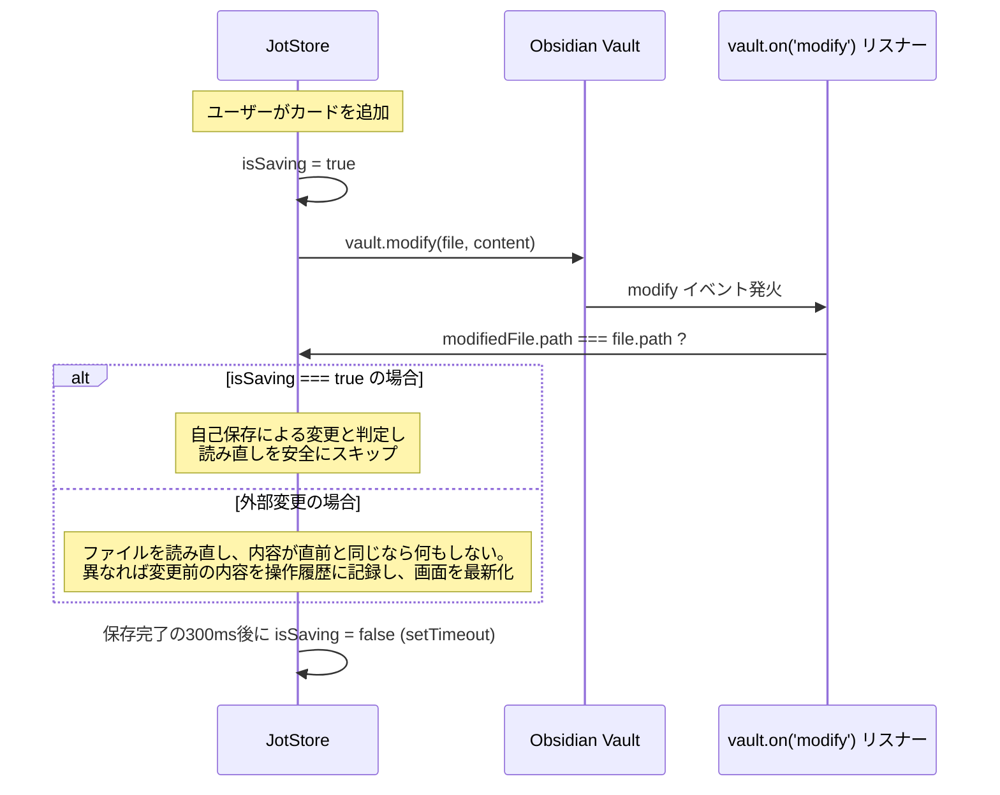

# JotLine 非機能要件・安全設計書 (Non-Functional Requirements)

---

## 1. データ整合性とファイル書き込みの安全性

### 1.1 一括アトミック上書き（Full-Document Overwrite）
JotLine では、行単位の部分置換（Regexによる部分書き換えなど）を行いません。

- **理由**: カードの追加・削除・並び替え・分割・統合が行われた際、部分置換では行番号のズレや構文の破損（Race Condition）が発生しやすいためです。
- **実装方針**:
  1. UI上の操作は、メモリ上の構造化データ（`JotDocument`）に対して行われます。
  2. 保存時は `serializeJotDocument(doc)` によってファイル全体のMarkdown文字列を再構築。
  3. 再構築した文字列が直前のファイル内容（最後に読み書きした内容）と同じなら、書き込みは行いません。
  4. 異なる場合は、Obsidianの `vault.modify(this.file, newContent)` を用いて一括で安全に書き込みます。書き込みに成功したら、変更前の内容をアンドゥ用の操作履歴に記録します（`01.Architecture.md` の「操作履歴（アンドゥ／リドゥ）」を参照）。

---

## 2. 競合制御とイベントループ遮断 (Concurrency Control)

Obsidian では、同じファイルを「JotLineビュー」と「標準Markdownエディタ（別ペイン）」で同時に開くことが可能です。また、プラグイン自身のファイル保存処理が Obsidian の `vault.on('modify')` イベントを発火させます。

これによる **無限更新ループ（自作自演の再読み込みループ）** を防ぐため、以下の制御を実装しています。

- **`isSaving` フラグ管理**: 保存処理（`vault.modify`）の直前にフラグを立て、完了（失敗時を含む）から300ms後に `setTimeout` で解除します。`modify` イベントが遅れて発火しても自己保存として扱うための猶予です。
- **外部変更の受容**: 外部（標準エディタ、Obsidian Sync、Git、他アプリ等）によってファイルが更新された場合は、`isSaving === false` のため直ちに最新内容をファイルから再パースし、UIを同期させます。なお、自己保存直後の300msの猶予中に発生した外部変更は検知されません（操作履歴にも記録されません）。また、再パースのたびにカード／グループのIDは再採番されます。
- **外部変更の操作履歴化**: 検知した外部変更は、変更前の内容を1件の操作履歴として記録し（リドゥ履歴は破棄）、アンドゥで外部変更前の状態に戻せるようにしています。読み直した内容が直前の内容と同じ場合（自己保存のイベントが猶予後に遅れて届いた場合など）は、何もしません。
- **読み直し後の表示状態**: 外部変更やアンドゥ／リドゥで表示を置き換えると、カードIDが振り直されるため、カードの選択はすべて解除されます。

---

## 3. 多言語対応 (i18n) アーキテクチャ

### 3.1 対応言語と自動検知
- **対応言語**: 英語 (`en`)、日本語 (`ja`)
- **検知ロジック**:
  1. `window.moment` が利用可能な場合は `window.moment.locale()`（Obsidian の表示言語に追従）のみを使用。
  2. `window.moment` が無い場合は `localStorage.getItem("language")`、それも無ければシステム設定（`navigator.language`）。
  3. 得られたロケールの先頭部分（`ja-JP` → `ja`）で辞書を選択し、未対応言語環境では英語（`en`）をフォールバックとして適用。
- 言語は `t()` の呼び出しごとに判定されます（コマンド名・リボンのツールチップはプラグインのロード時点の言語で確定）。

### 3.2 辞書リソース管理 (`src/i18n/`)
- 主要なUIテキスト（コマンド名、ツールチップ、コンテキストメニュー、設定項目、Notice通知）を言語リソースファイル（`src/i18n/locales/en.ts`, `ja.ts`）に集約。`ja.ts` は `typeof en` で型付けされ、キーの過不足はコンパイル時に検出されます。
- ※一部のテキストは辞書化されておらず英語固定です（グループ化・グループ化解除・一括削除・スレッド名変更の完了通知、ファイル読み書き失敗やスクラッチパッド生成に関する通知、設定画面の見出しなど）。
- **動詞ベースの統一ツールチップ**: ボタンを押した際の結果が直感的に伝わる表現を採用（例：「スレッドを折りたたむ」「上のカードと統合」「Markdownとしてコピー」等）。

---

## 4. AI・LLMエージェントとの協調設計

生成AIや自律型コーディングエージェントがVault内のファイルを安全に読み書きできるよう、自動仕様生成機能を備えています。

- **`_jotline.readme.md` の自動配置**:
  - `autoCreateScratchpad` が有効な場合、プラグイン起動時（`onLayoutReady`）およびスクラッチパッドを開く際に、Vaultルートに `_jotline.readme.md` が存在しなければ本仕様の要約ドキュメントを自動生成（既存ファイルは上書きしません。内容は日本語の固定テンプレート）。
  - AIエージェントに対して「どのコメントマーカーが何を意味するか」「カードを追記する際はどこに `<!-- card -->` を挿入すべきか」を明示し、エージェントによるファイル破壊を防止。

---

## 5. ドラッグ＆ドロップによる移動の安全性

JotLine ビューとノート・別の JotLine ビューの間の移動（`01.Architecture.md` の「6. ドラッグ＆ドロップ」）は、2つのファイルにまたがる操作のため、次の方針でデータの消失と破損を防ぎます。

- **「追加してから削除」**: ドロップ先への追加に成功したことを確かめてから、元を削除します。途中で失敗しても、内容は重複して残ることはあっても失われません。
  - JotLine ビューへの追加：`JotStore` の追加メソッドが保存の成否を返し、成功した場合だけ元を削除します。
  - ノートへの挿入：エディタの標準動作で挿入された後（`setTimeout(0)`）、ノートの内容に挿入テキストが含まれることを確かめてから元を削除します（位置までは確かめない。もともと同じテキストがノートにあった場合は成功とみなすが、その場合もノートに内容が存在するため失われない）。
  - ノートからの削除：元の範囲の内容がドラッグ開始時から変わっていないことを確かめてから削除します。
- **書き込み失敗時の表示の巻き戻し**: JotLine 側の追加・削除で書き込みに失敗した場合は、表示をファイルの内容（変更前）に戻し、失敗した変更が次の操作の保存で書き込まれないようにします。
- **同じファイルどうしの禁止**: 同じファイルを JotLine とエディタ（または2つの JotLine ビュー）が同時に書き換えると、JotLine の全体上書き保存とエディタの保存が衝突するおそれがあるため、同じファイルへのドロップ（ノート・タイムライン）は行いません。メイン入力欄への挿入はファイルを書き換えないため、許可しています。
- **古いドラッグ情報の誤用防止**: ドラッグの元が削除されて `dragend` が届かない場合に備え、ドラッグ開始のたびにドラッグセッションを破棄し直し、ドロップ先では転送データの種類やテキストの一致を確かめてからセッションを使います。
- **元に戻せること**: JotLine 側の追加・削除は操作履歴（アンドゥ）に、ノート側の挿入・削除はエディタの編集履歴に残るため、移動はそれぞれの側で元に戻せます。

---

## 6. パフォーマンスとリソース管理

1. **DOMの軽量化**:
   - Svelte による仮想DOMオーバーヘッドのない直接DOM更新。
   - スレッドの折りたたみ（アコーディオン）により、長大なストリームでも不要なDOM展開を抑制。
2. **メモリリーク防止**:
   - ビューが閉じられた際（`onClose`）および表示ファイルの切り替え時（`setFile`）、Svelteアプリを破棄し、`JotStore.destroy()` で登録済みの `modifyEventRef` を確実に解除。
   - カード破棄時（`onDestroy`）に、`MarkdownRenderer` 用の Obsidian `Component` を `unload()` してクリーンアップ。
