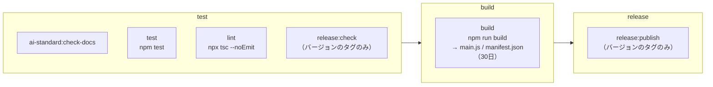
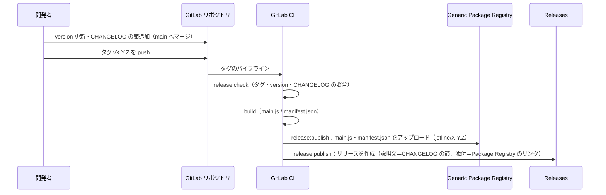

# JotLine ビルド・CI・リリース設計書 (Build & Release)

---

## 1. 概要

JotLine のビルド結果（`main.js`）はリポジトリに含めず（`.gitignore` 対象）、GitLab CI でビルド・検証し、配布物を GitLab 上で管理します。

| 対象 | 管理方法 |
|---|---|
| 検証（check-docs・テスト・lint）とビルド | GitLab CI のパイプライン（`.gitlab-ci.yml`） |
| 開発中のビルド結果 | ビルドのジョブのアーティファクト（`main.js`・`manifest.json`、30日） |
| リリースした版 | GitLab の Releases（説明文は `CHANGELOG.md`）＋ Generic Package Registry（`main.js`・`manifest.json`） |

- GitLab は自前のサーバー（`gitlab.sasaki819.mydns.jp`、プロジェクト `open/jotline`、公開）。
- GitLab Runner は docker executor で、タグなしのジョブも実行する。Runner の既定のイメージ（プレーンな Alpine）には Node.js がないため、Node.js が必要なジョブはイメージを明示的に指定する。

---

## 2. パイプライン（`.gitlab-ci.yml`）

### 2.1 動かす対象

`workflow:rules` で、次のときだけパイプラインを作ります。

- MR（`$CI_PIPELINE_SOURCE == "merge_request_event"`）
- 既定のブランチ（`main`）への push
- タグの push

MR のない `item/*` などのブランチへの push では動きません。MR を作ったブランチへの push では MR のパイプラインだけが動き、ブランチのパイプラインと二重になりません。

### 2.2 ステージとジョブ

| ジョブ | ステージ | 内容 | 対象 |
|---|---|---|---|
| `ai-standard:check-docs` | test | `bash tools/ai-standard/check-docs.sh`（`ci/ai-standard.gitlab-ci.yml` を取り込む。イメージは `debian:stable-slim`） | すべて |
| `test` | test | `npm test` | すべて |
| `lint` | test | `npx tsc --noEmit` | すべて |
| `release:check` | test | `node scripts/release.mjs check "$CI_COMMIT_TAG"` | `vX.Y.Z` のタグのみ |
| `build` | build | `npm run build`。`main.js`・`manifest.json` をアーティファクトとして30日保存（ブランチごとの最新のものは、GitLab の既定の設定により期限後も残る） | すべて |
| `release:publish` | release | `node scripts/release.mjs publish "$CI_COMMIT_TAG"`（build のアーティファクトを使う） | `vX.Y.Z` のタグのみ |

- 前のステージのジョブが1つでも失敗すると、パイプラインは失敗し、以降のステージは動きません。したがって、検証かリリース前チェックに失敗した場合は、リリースは作られません。
- Node.js のジョブは共通の設定（`.node`）を継承します：イメージ `node:24-bookworm-slim`、`package-lock.json` をキーにした npm のキャッシュ（`.npm/`）、`npm ci --cache .npm --prefer-offline`。
- `release:check`・`release:publish` は、リリースのスクリプトが Node.js の組み込みモジュールだけを使うため、`npm ci` とキャッシュを省きます。
- `vX.Y.Z`（`X`・`Y`・`Z` は数字）以外のタグでは、検証とビルドだけが動きます。

---

## 3. リリース

### 3.1 流れ

開発者の手順は、利用者向けの `README.md` の「Releasing」に書いてあります。

### 3.2 リリース前チェック（`check`）

次のすべてを満たさなければ失敗し（終了コード1）、リリースは作られません。

- タグが `vX.Y.Z` 形式である。
- タグのバージョン `X.Y.Z` が、`manifest.json` の `version` および `package.json` の `version` と一致する。
- `CHANGELOG.md` に、`## [X.Y.Z]` で始まる、本文が空でない節がある。

`check` は GitLab の API を使わないため、手元でも `node scripts/release.mjs check vX.Y.Z` でリリース前の確認に使えます。

### 3.3 公開（`publish`）

`check` と同じ確認のあと、次を行います（GitLab CI のタグのパイプライン専用。CI の定義済み変数 `CI_API_V4_URL`・`CI_PROJECT_ID`・`CI_JOB_TOKEN`・`CI_PROJECT_URL` を使い、ない場合は何もせず失敗する）。

1. `main.js`・`manifest.json` を Generic Package Registry にアップロードする（`PUT <api>/projects/<id>/packages/generic/jotline/<X.Y.Z>/<file>`、ヘッダー `JOB-TOKEN: $CI_JOB_TOKEN`）。期限なく保存される。
2. Releases API でリリースを作る（`POST <api>/projects/<id>/releases`、ヘッダー `JOB-TOKEN`）。
   - 名前：`JotLine vX.Y.Z`、説明文：`CHANGELOG.md` の該当節
   - 添付：`main.js`・`manifest.json` の Package Registry へのリンク（`link_type: package`）。`direct_asset_path` により `<プロジェクトURL>/-/releases/vX.Y.Z/downloads/main.js` などの固定の URL でもダウンロードできる。

- 追加のトークンの登録は不要（`CI_JOB_TOKEN` でアップロードとリリースの作成ができることを確認済み）。
- HTTP の呼び出しは Node.js 組み込みの `fetch` を使い、追加の依存パッケージはない。
- アップロードに失敗した場合は、リリースを作る前に失敗する。リリースの作成に失敗した場合（同じタグのリリースが既にある、など）は、アップロード済みのファイルが Package Registry に残る。

### 3.4 スクリプトの構成

| ファイル | 内容 |
|---|---|
| `scripts/release-lib.mjs` | 純粋関数：`parseVersionTag`、`checkVersions`、`extractChangelogSection`、`buildPackageFileUrl`、`validateRelease`（Vitest で単体テスト。`scripts/release-lib.test.mjs`） |
| `scripts/release.mjs` | コマンド：`check <tag>`、`publish <tag>` |

- `scripts/` は JavaScript（`.mjs`）で、ビルドなしに Node.js でそのまま実行する。`tsconfig.json` の型検査（`src/**`）の対象外で、テストは `npm test`（Vitest の既定の探索）に含まれる。

---

## 4. バージョンと変更履歴

- バージョンは Semantic Versioning（`X.Y.Z`）。`manifest.json` と `package.json` の `version` を同じ値に保ち、タグ `vX.Y.Z` と一致させる（`check` で照合）。バージョン番号の付与は人が行う。
- `CHANGELOG.md`（英語）は Keep a Changelog の形式で、バージョンごとに `## [X.Y.Z] - YYYY-MM-DD` の節を設ける。この節がリリースの説明文になる。
- 初回のリリースは 1.0.0（それまでの機能を 1.0.0 の節にまとめる）。
- 必要な Obsidian のバージョン（`manifest.json` の `minAppVersion`）は 1.1.0。Obsidian のコミュニティプラグイン一覧への登録と、そのための `versions.json` は対象外。
