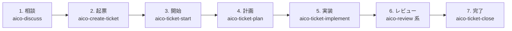

# 02. チュートリアル（最初の 1 チケットを回してみよう）

## 概要

AIco を導入したあと、小さな変更を題材に **相談 → 起票 → 開始 → 計画 → 実装 → レビュー → クローズ** までを 1 周体験するためのハンズオンです。  
AIco の基本は **「人間が判断し、AI が手順と実務を先導する」** ことなので、すべてのスキル名や細かいルールを暗記する必要はありません。

## 全体イメージ（1 チケットの流れ）



※やる内容が最初から明確な小さな作業なら、Step 1（相談）を飛ばして Step 2（起票）から始めても大丈夫です。

## 題材の例

ここでは「`README.md` にローカル開発手順を追記する」といった小さなタスクを例に進めます。  
まずは統合ブランチ（`main` や `develop`）にいる状態で AI エージェントを開いてください。

## Step 1：やりたいことを AI に相談する（任意）

方針がまだふわっとしているときは、まず相談スキルで壁打ちします。

```text
/aico-discuss README にローカル開発手順を追記したい。何を書くと良さそうか相談したいです。
```

AI が議事録を作成しながら確認事項を整理してくれます。  
方針が固まったら「この内容で議事録を確定してください」と伝えます。

## Step 2：チケットを起票する

ゴールが決まったら、統合ブランチ上でチケットを作成します。

```text
/aico-create-ticket README にローカル開発手順を追記するチケットを起票してください。
```

AI が `management/04.tickets/<チケットID>/` にチケットフォルダを作り、概要・受け入れ条件（AC）・着手合意（DoR）の案を提示してくれます。  
内容に問題がなければ、起票した記録を統合ブランチへコミットしておきます。

## Step 3：着手合意して作業ブランチを作る

チケットの内容と「AI に任せる範囲」に納得できたら、作業を開始します。

```text
/aico-ticket-start このチケットの DoR を合意します。作業ブランチを作って着手してください。
```

AI が作業ブランチ（例：`feature/<チケットID>`）を作成して切り替え、チケットを進行中状態へ更新します。

## Step 4：作業計画（`plan.md`）をすり合わせる

いきなり編集を始めず、まずは計画を立ててもらいます。

```text
/aico-ticket-plan 作業計画を作成してください。
```

AI が既存ファイルを調査し、`plan.md` に変更方針・ステップ一覧・確認方法を書いたうえで承認を求めてきます。  
計画を見て問題なければ「設計フェーズは不要なので、このまま実装へ進んでください」と返します。

## Step 5：実装と検証を任せる

計画が合意できたら、実装スキルで進めます。

```text
/aico-ticket-implement plan.md に沿って実装と検証を進めてください。
```

AI が `plan.md` のチェックボックスを消化しながら編集とテスト・確認を行い、結果を報告してくれます。

## Step 6：独立レビューと修正を回す

実装が終わったら、作ったセッションとは別の独立ワーカーにレビューしてもらいます。

```text
/aico-review 今回の変更内容をレビューしてください。
```

指摘が見つかった場合は、以下の流れで進めます。

1. **`/aico-review-triage`**：AI が指摘一覧を提示するので、人間が「直す（採用）／今回は直さない（見送り）」を決めます。
2. **`/aico-review-fix`**：採用した指摘を AI に修正してもらいます。
3. **`/aico-review-recheck`**：独立ワーカーに修正結果を再確認してもらいます。

※人間が成果物を見て気づいた点を直接指摘したい場合も、`/aico-review` に指摘内容を伝えて「人間レビュー指摘として記録して直してほしい」と依頼できます（即採用 `in-progress` で登録され、そのまま `/aico-review-fix` へ進めます）。

## Step 7：クローズして統合ブランチへ取り込む

AC（受け入れ条件）を満たし、レビューも完了したらチケットをクローズします。

```text
/aico-ticket-close DoD を確認してクローズ準備をしてください。
```

AI が変更ファイル一覧（作業ツリーの未コミット変更・新規ファイルも含む）を自動更新し、完了条件（DoD：AC 検証・設計書更新・ADR 要否など）の確認を提示します。  
事前の仮コミットは不要です。承認して完了状態が確定したら作業ブランチをまとめて 1 回コミットし、必要に応じて `/aico-ticket-pr`（任意）で PR/MR の説明文を生成して統合ブランチへマージしてください。  
マージ後、統合ブランチ側でもう一度一覧更新（`tools/aico.sh rebuild_indexes` または `/aico-ticket-close` の統合後処理）を行うとダッシュボードへ反映されます。

## 途中で中断・別セッションになったときは？

翌日に再開するときや、別の AI ツールへ切り替えたときは、まず次のひとことだけで大丈夫です。

```text
/aico-ticket-status 今の状況を確認して、次に何をすれば良いか教えてください。
```

AI が現在のブランチ・チケット記録・未解決のレビュー指摘を実物照合し、再開ポイントと次に実行すべきスキルを案内してくれます。

## 次に読むガイド

* 普段使いでスキル名やコマンドを素早く確認したい → [チートシート](03.cheatsheet.md)
* 記録の使い分けや困ったときの対処を知りたい → [使いこなしガイド・FAQ](04.user-guide.md)
